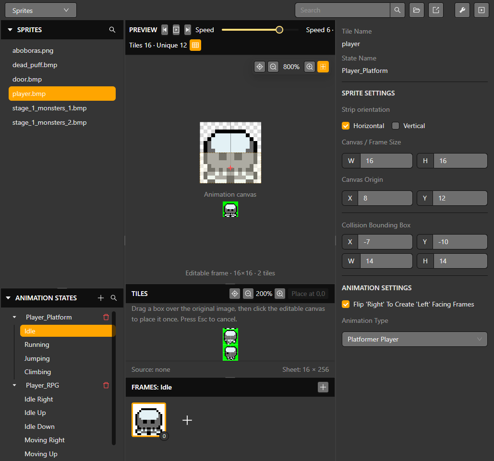
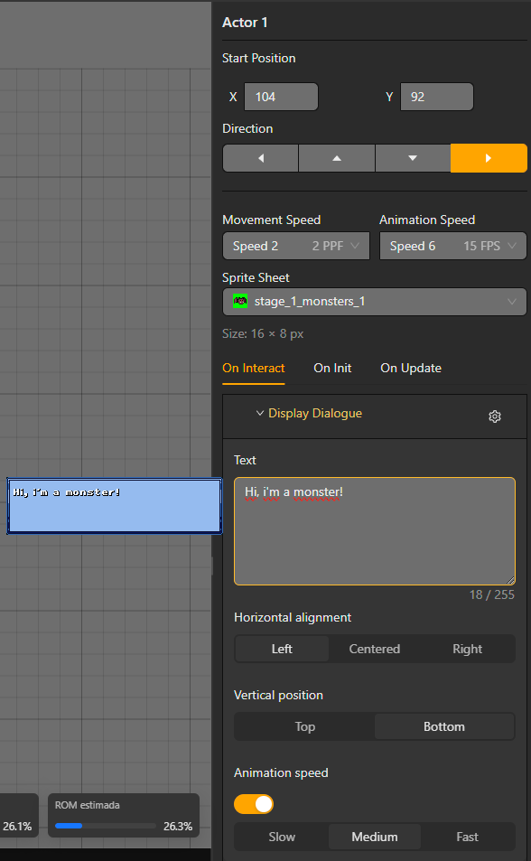

# Actors and interactions

An actor is a sprite instance placed in a scene. Its resource defines appearance and animation; its scene instance defines position and behavior.

## Add an actor

1. Create or select a sprite in the Sprites Editor.
2. Add an actor to the scene and assign the sprite.
3. Set its position, priority and initial visibility.
4. Attach an event script to its interaction or lifecycle entry point.

The Sprites Editor provides tile and frame panels for authoring animation. The same resource-editor shell is used for its resizable panels, so the selected resource and its properties remain visible while working.

## Interaction example

Create a script containing a dialogue event followed by a scene or actor change. Use `EVENT_DISPLAY_DIALOGUE` for the blocking text, then continue with `EVENT_MOVE_ACTOR`, `EVENT_SPAWN_ACTOR` or `EVENT_CHANGE_SCENE`. Blocking events pause the rest of that script; instant events execute and advance immediately.

For dynamic behavior, use variables and `EVENT_IF`, `EVENT_WHILE`, `EVENT_FOR`, `EVENT_BREAK` and `EVENT_CONTINUE`. Keep loops bounded and avoid doing expensive work every frame on hardware.

The generator sizes actor tables for the project. The GBA has 128 hardware sprite entries shared by actors, composed sprites, UI and dialogue; a composed actor can use several entries. Remove unused instances and check the runtime monitor rather than treating 16 actors as a universal limit.

## Direction, facing tests and tracking a target

**Set Actor Direction** turns the target up, right, down or left without moving it. **If Actor Is Facing Target** tests the observer's current direction against another actor or the player; it does not turn the observer automatically.

Enable **Look in X** and/or **Look in Y** and set each axis's maximum distance in pixels or tiles. A maximum of `0` is unlimited on that axis. An axis switched off is not tested, so an X-only test can succeed even when the player is far above or below the observer. A Y-only test describes a vertical facing region, not automatic tracking around every side. Use the preview to inspect the effective region.

To make an NPC watch the player while the player moves, compare their positions in On Update and choose Set Actor Direction for the appropriate branch. A facing condition can decide whether to react, but an If/Else alone will not rotate the NPC unless its branches set a direction.

## Lifecycle and offscreen behavior

Actors have **On Init**, **On Interact** and **On Update** scripts. Interaction requires contact between the configured colliders and a valid interaction input. On Update scripts advance cooperatively; a Wait delays that script rather than stopping the whole game.

Enable **Keep running while offscreen** when an actor must keep its scripts and movement active outside the visible camera area. Hover the label for its On/Off explanation. Leave it off for actors that can suspend offscreen work. **Show collider** controls the editor's collision overlay for that actor.

Use **Spawn Actor** with an actor prefab when new instances should share a definition, and **Remove Actor** to remove instances that are no longer needed. See [Prefabs](./prefabs) and [Movement and physics](./physics).

## Appearance controls

Use the dedicated **Set Actor Rotation**, **Set Actor Scale**, **Actor Color Overlay**, **Hide Actor** and **Show Actor** events for the selected appearance change. Rotation, scale and color duration are configured by their respective events. Animation state, animation playback and a forced frame are different from sprite visibility or transform settings.
