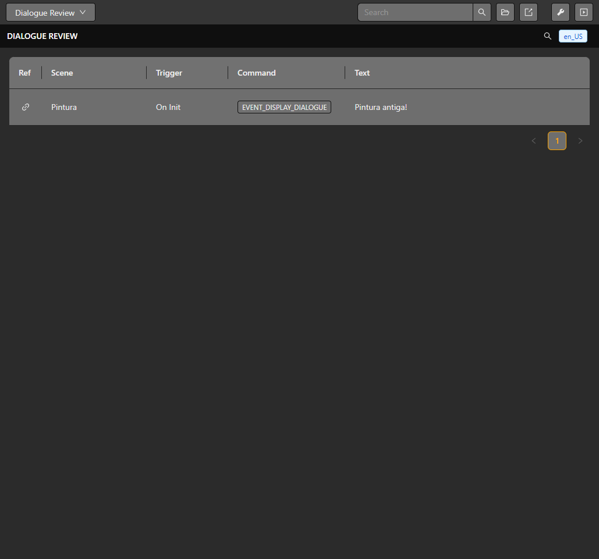

# Dialogue and choices

Dialogue can be configured in an event list and reviewed across the project with **Dialogue Review**. The dialogue event controls text, font, frame, alignment, animation and optional avatar placement. **Open Menu** adds selectable options and write a result to a variable.

## Add dialogue to a scene

1. Open the scene, actor or trigger event list that should show the line.
2. Add **Display Dialogue** and enter the text. Choose the font, frame, alignment and animation options that fit the scene.
3. If using a portrait, enable it, select an image and configure its size and placement.
4. Let the blocking dialogue complete its confirmation flow before subsequent events execute. Use **Hide Dialogue** from a separately running sequence when an open box must be closed explicitly.
5. For a choice, add **Open Menu**, enter each option and select a result variable.

## Review dialogue

Open **Dialogue Review** from the editor selector to search dialogue entries and open the owning context. Use review to catch repeated, empty or inconsistent lines before building. The review table is an editing aid; it does not prove the text will fit the target screen.

*Dialogue Review identifies each line by its owning scene, trigger and event.*

Run the ROM in the emulator to verify font glyphs, wrapping, animation, portraits and choices. Font and avatar placement use GBA screen coordinates, so inspect the result at the target resolution. See [UI and fonts](./ui-and-fonts) and [Event reference](../reference/events).

## Variables in text and byte count

Type `$` at the insertion point to choose a variable. Filter by name or symbol, then click a suggestion or use the arrow keys and Enter. The editor inserts a short reference such as `${score}` and preserves text around the cursor. Deleted variables are not selectable.

Reference syntax does not consume the text budget. The byte counter uses the variable's initial value: `${score}` counts as 2 bytes when the initial score is `42`. The runtime substitutes the live value and limits the resulting text to 255 UTF-8 bytes. An accented character can occupy more than one byte. Changing values during play can therefore change the rendered length; design space for the expected values.

Display Dialogue is blocking and waits for its normal confirmation/close flow. A Hide Dialogue placed after it cannot run while that dialogue is still waiting. Do not disable the physical button needed for confirmation. Dialogue itself suspends normal player movement; use [Input groups](./controls) only when their button-blocking behavior is intended.

## Menu layout

Use **Open Menu** for selectable options and a result variable. Choose the available layout, columns, title, initial selection and cancellation behavior in the event. Narrow side layouts have a smaller title budget than a full-screen menu. Preview the actual option placement and test the chosen confirmation/cancel mappings in the ROM.
