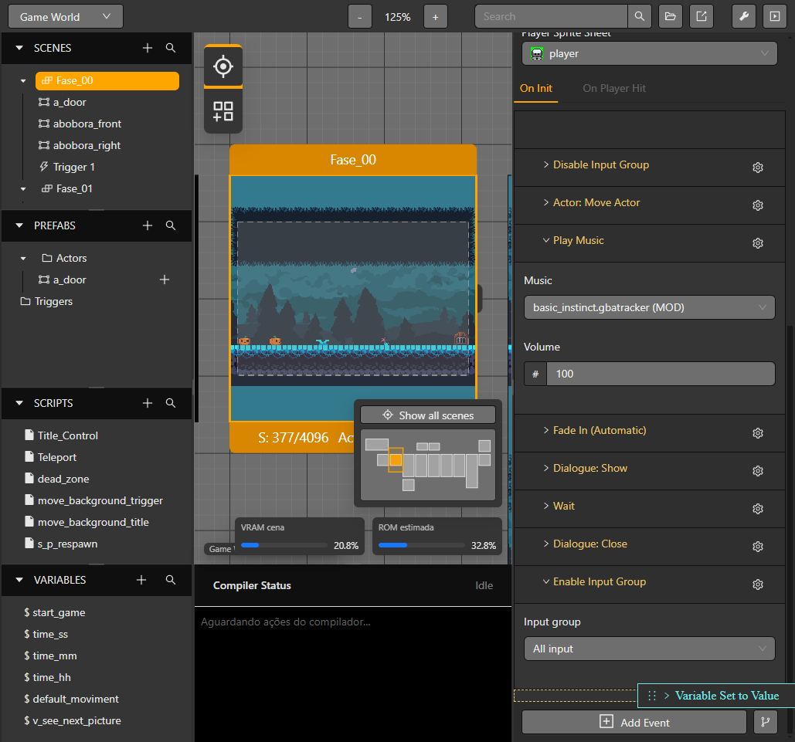
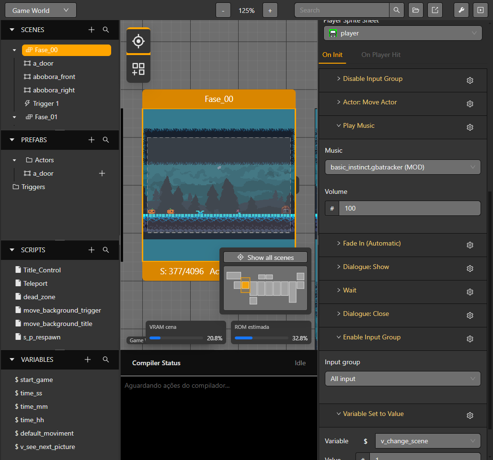
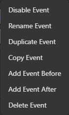
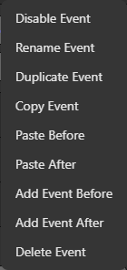
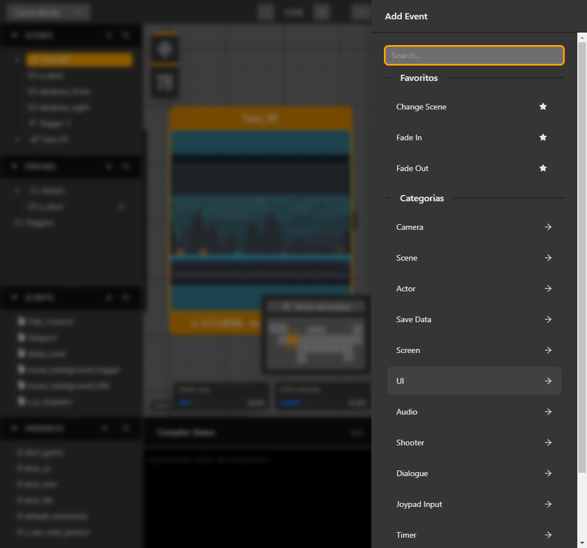

# Organize events

An event list belongs to its current scene, actor, trigger or reusable script. Open that context and choose **Events** to edit its sequence. The gear menu works on the event beside it; the menu filters actions that do not apply to that event or clipboard state.

## Reorder and nest events

1. Expand the event whose children you want to edit.
2. Drag an event row to the insertion marker above or below another row. Drop it on a branch when the destination should be inside a block such as **If**, **While**, **For**, **Switch**, or a save callback.
3. Drop a nested event at the root list to move it out of its parent. The highlight marks the destination before you release the pointer.
4. Check the final order and branch indentation before continuing.

The editor keeps event IDs while moving a block. It rejects a move that would place an event inside itself, create an unsupported branch, or put **Break** or **Continue** outside a loop. **Switch Case** entries are created from their parent Switch and use the Switch value's type.

*The highlighted insertion marker shows the root destination before the pointer is released.*

*After release, the event that was first appears after the previous last event.*

## Use the gear menu

Open the gear beside an event. The actions are ordered as **Enable/Disable**, **Rename**, **Duplicate**, **Copy**, **Paste Before**, **Paste After**, **Add Before**, **Add After**, and **Delete** where applicable.

*The selected event's gear shows Duplicate and Copy before the insertion actions.*

- **Duplicate** makes a separate event directly in the current list.
- **Copy** stores the event and its nested branches in the event clipboard. Press **Esc** to clear the clipboard.
- **Paste Before** and **Paste After** insert a deep copy relative to the event whose menu is open. The options appear only while the clipboard has a compatible event. New IDs are created for the copied event tree.
- **Add Before** and **Add After** open the event picker and insert the selected event at that position. The same controls are available for nested rows.

*Copying an event adds the two paste positions to the destination event menu.*

*The event picker opens from Add Event Before and inserts the chosen event at that position.*

The clipboard is available while changing scenes or opening another actor or trigger. The destination still applies its own event rules: an event unavailable in that context cannot be pasted there. Review the inserted block and any resource references after pasting.

For payloads and supported event codes, see [Event reference](../reference/events). For conditions and loops, see [Variables and conditions](./variables-and-conditions).

## Previews and operation actions

When preview-enabled events are nested, the child preview takes priority while its fields are hovered or focused, including after scrolling or clicking its controls. Leaving the child restores the eligible parent preview.

Game Data Save owns **On Save** actions and Game Data Load owns **On Load** actions. The visible tab edits that event's own success actions; selecting it does not change runtime execution. See [Save and load](./save-and-load).
