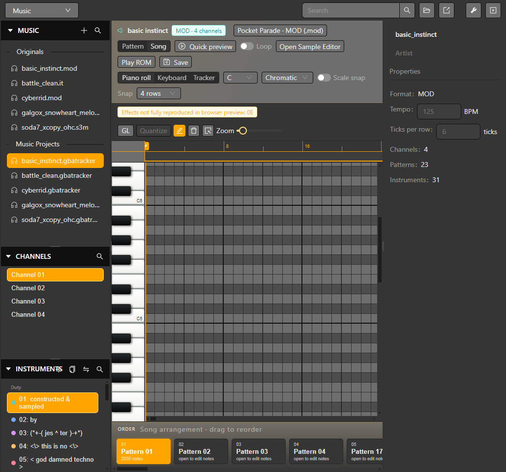

# Music editor

Open **Music** in the editor selector and choose a project module. The editor supports MOD, XM, S3M and IT assets, with editing controls depending on the file format. A control shown for one format may be unavailable for another.

## Import or compose

1. Add a supported music file to the project, or create a scratch module in a format that supports creating instruments.
2. Select a pattern and channel in the tracker grid. Enter notes and supported effects, then use the order list to inspect playback sequence where the format allows editing orders.
3. Select an instrument or sample to review its zones and envelope controls. Importing WAV samples is available for supported modules; check the format-specific controls before editing.
4. Use Play and Stop to preview the module. Compare playback with the source file after editing.
5. Save the project and select the asset in a **Play Music** event.

When editing imported modules directly, XM exposes the broadest set of composition controls. MOD, S3M and IT expose a narrower set based on their module structure. Editable project compositions have their own capabilities, listed below. The editor's disabled controls are the source of truth for a particular asset. ROM preview and final output can differ from desktop audio playback; validate the compiled module in the emulator.

*The selected MOD module exposes its channels, instrument list, piano roll and order sequence.*

This sample module contains an effect that the browser preview does not fully reproduce; the editor marks that limitation above the piano roll. It does not prevent inspecting the module or building it.

See [Sound effects](./sound-effects) and [Dialogue](./dialogue) for the other audio workflows.

## Imported modules and editable project compositions

Capabilities depend on both the format and whether the resource is an editable project composition. Editable project compositions support pattern names/order, instrument creation, volume controls and tempo; variable pattern lengths are available for XM and IT. Project instrument limits are 31 for MOD, 99 for S3M and 128 for XM/IT. Directly editing an imported module exposes a narrower set of controls. WAV sample import is supported for MOD, XM, S3M and IT.

Instrument controls include volume/pan presentation, envelopes and sample zones where the selected resource supports them. The pan dial shows left/center/right positions and percentage values. Warnings distinguish desktop playback limits from effects or formats that the build path cannot reproduce. Use ROM Preview or a normal build to compare the generated result before relying on a desktop preview alone.
