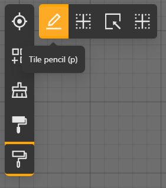
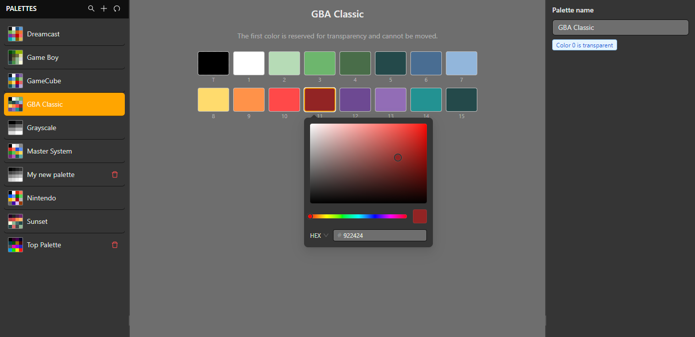
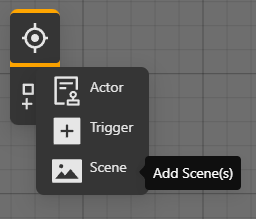

# Scenes, layers and palettes

Scenes are the visual spaces of a game. A scene combines background layers, palette choices, actors and scripts. The Game World shows the composition; the right panel edits the selected object.

## Create a scene

1. Create a scene from the project resource list.
2. Add a background to a layer and choose its palette.
3. Use the layer controls to select the active background and visibility.
4. Place actors on the scene and save before testing.

The GBA has strict tile, palette and memory limits. Prefer indexed assets prepared for the target display and validate the scene with **Play** or a build early rather than waiting until the end.

## Palette workflow

Use the Palettes Editor to create and edit reusable palettes. The list follows creation order, which keeps newly imported palettes near the end of the collection. Select the palette object to edit it in the right panel; the selected resource uses the same active-item treatment as the Game World.

The scene menu also exposes context-sensitive actions when a scene is selected; use the action that matches the selected resource instead of editing generated files.

## Runtime changes

Use `EVENT_CHANGE_LAYER`, `EVENT_VISIBLE_BACKGROUND` and `EVENT_CHANGE_PALETTE_BACKGROUND` from a script when a scene must change during play. Keep layer IDs explicit and test the transition in the emulator because a visual change can also affect tile and palette constraints.

## Scene type and coordinates

The scene-type selector offers **Top Down**, **Platformer**, **Adventure**, **Point Click** and **Logo**. Controls are configured independently for each type in [Settings > Controls](./controls). Use the scene type's available events; an internal engine capability in the reference catalog is not necessarily a scene type offered by the editor.

Coordinate event pairs include a unit beside each axis. X can use pixels while Y uses tiles; each axis is converted separately, and one tile is 16 pixels. This applies to Change Scene destinations, camera movement, actor placement/movement, Scroll Background and positioned UI where those fields are available. Change Scene uses coordinates in the destination scene, not the scene's position in the Game World workspace.

Use the default palette slots in Settings to assign project palettes. Palette-change events can use an explicit palette or restore the configured defaults. Keep background layer IDs distinct from palette slot IDs.

## Background animation and transforms

**Animate Background** selects a layer, a frame source and its animation settings, including frame dimensions, range, direction/reverse, timing units and loop behavior where offered. Inspect the preview before building. **Set Background Scale**, **Rotation** and **Shear** change the selected layer's transform; use formats and scene contexts accepted by the editor.

**Scroll Background** uses its own X and Y units. Layer visibility, scrolling, palette changes and frame animation are separate operations; changing one does not select a different layer automatically.
