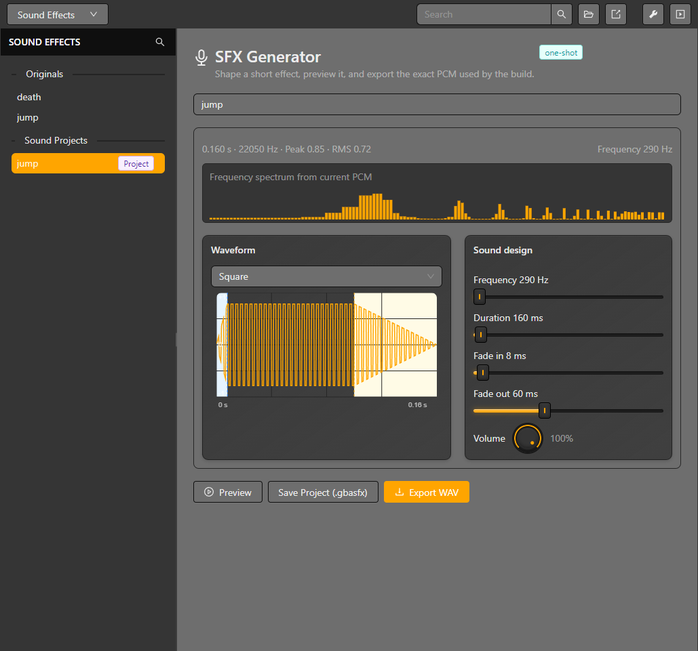

# Sound effects

Open **Sounds** from the editor selector to manage sound assets. The SFX generator creates a sound resource from editable synthesis parameters; imported audio can be prepared as a project asset. The project library lists available sounds for **Play Sound** events.

## Create or import a sound

1. Open **Sounds** and add a sound asset or create one with the generator.
2. For a generated sound, adjust the waveform, pitch, duration and envelope controls, then preview it.
3. For an imported asset, review its format and project path and preview it before saving.
4. Save the resource and add **Play Sound** to the scene, actor or trigger event list.
5. Select the sound and set its volume if the event exposes that option. Build and listen in the emulator.

Desktop preview helps compare edits, but it does not guarantee the same result on GBA hardware. The generated asset and compiler path determine the runtime result. Keep a short test scene when checking audio changes and verify the ROM after changing a sound resource.

*The generated effect's waveform, spectrum, synthesis parameters and export controls are visible together.*

For tracker modules, see [Music editor](./music-editor). For event payloads, see [Event reference](../reference/events).

## Play Sound controls

**Play Sound** uses the same custom dials as the sound editor: the title sits above each dial and its changed value below. Volume is 0-100%, Speed is 25-400%, and Pan is -100 to 100. Pan uses the music editor's left/center/right scale with 25-point steps; its value reads **L n%**, **Center** or **R n%**. These three dials edit literal playback settings rather than numeric-variable selectors.

**Priority** applies between sound effects, not against music. A higher number has higher priority. The runtime supports four simultaneous sound-effect channels; priority controls which effects can take a channel when the limit is reached.

## Sound groups and stopping

Set a group name in Play Sound to address its playback from **Stop Sounds**. The name is added to the group's selection list after editing the field is complete, rather than saving the project on every keystroke. Stop Sounds offers discovered group names and an all-sounds option.

A group currently retains the most recently played handle with that name. Stopping a group stops that retained sound; it is not a mixer bus that stops every overlapping earlier playback. Use the all-sounds choice to stop all effects. Music playback is controlled separately by Play/Stop Music.
