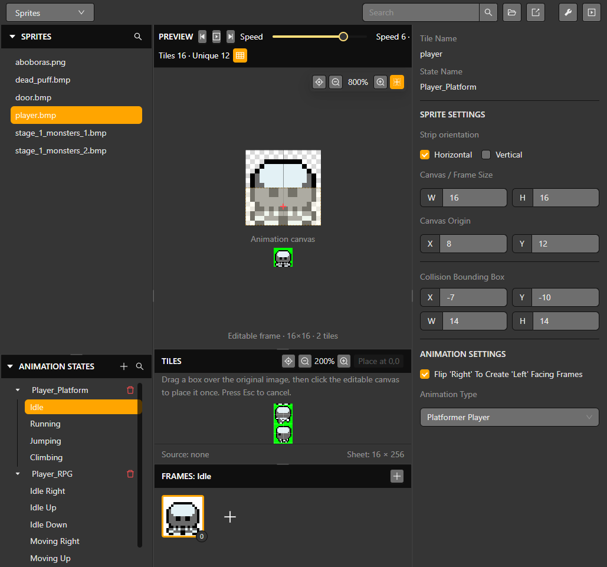

# Sprite animation editor

Open **Sprites** from the top editor selector. The left side lists sprite assets and animation states; the center shows the sprite and editable canvas frames; the inspector contains sprite and animation settings.

## Configure a sprite

1. Select a sprite in the asset list.
2. Set the sheet orientation and frame width and height so the source is divided correctly.
3. Select or create an animation state, then choose the animation type that matches the directions and movement states used by the actor.
4. Add canvas frames from source tiles. A canvas frame can combine source pieces; position each piece on the canvas and check the preview.
5. Reorder frames by dragging their thumbnails. The selected order is the playback order. Use the playback controls and speed selector to inspect the result.
6. Save and preview the actor in a scene.

Sprite assets can be larger sheets, so the **Tiles** area is where source regions are selected. The **Frames** row contains the composed animation frames. Changing the canvas does not replace the original source image. Confirm dimensions, origin and collision box in the inspector before using the sprite in the runtime.

*The selected state and frame group are shown alongside the preview canvas and sprite inspector.*

Frame dimensions and actor animation settings affect runtime resource use. Check [Limits and compatibility](../reference/limits-and-compatibility) before using many large sprites.

## Rename and preview

Hover the sprite or animation-state name in the right inspector to reveal its editable border, then click to rename it. Review the selected state and frame before editing a different resource. Source sheet edits, composed canvas frames and an actor's selected animation state are separate choices.
