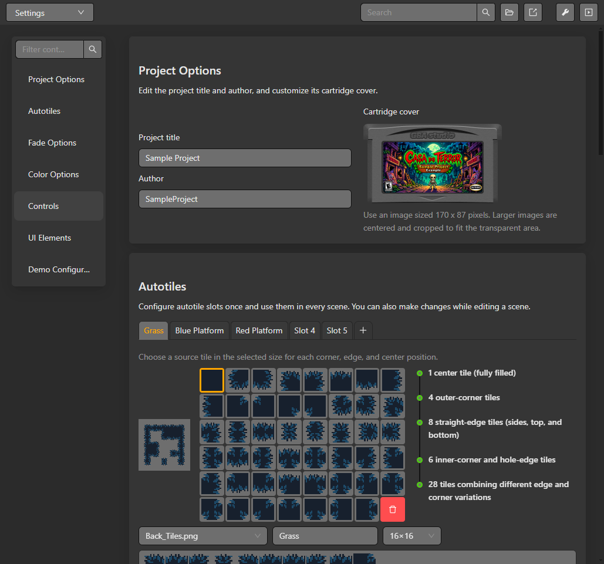

# Tiles and auto-tiles

Open a scene in **Game World** and choose a layer or tile tool. Tile maps belong to a scene background layer; a scene can have multiple layers with separate visibility and palette settings.

## Configure auto-tiles in Settings

Open **Settings** and select **Autotiles** to configure reusable terrain patterns. Choose a slot and source tiles for the center, edges and corners; the preview shows the combinations used to fill connected terrain.

*Configure an autotile pattern once in Settings, then use it while painting scene layers.*

## Paint a tile layer

1. Select the scene and the layer you want to edit.
2. Choose a tileset in the layer inspector. The tile palette shows available source tiles.
3. Select a tile or use the selection tool to place a group on the canvas.
4. Use the grid and zoom controls to align the placement. Check the layer visibility and collision settings before testing the scene.
5. Save and run the project to confirm the GBA output.

Auto-tiles choose neighboring tile graphics from a configured pattern. Select the auto-tile resource and inspect its pattern before painting; the selected pattern determines how edges and corners are filled. Animated tiles use their configured frames and timing. The editor preview confirms the map selection, while a ROM run confirms the compiled result.

Palette limits and supported tile dimensions depend on the selected asset and target build. See [Scenes and layers](./scenes-and-layers) and [Resource schemas](../reference/resource-schemas) for the scene data structure.
