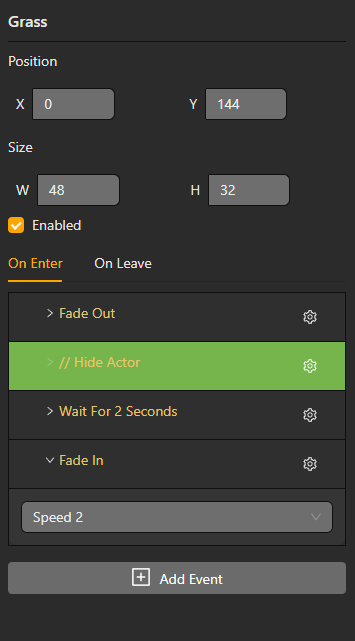

# Triggers and input

Triggers and actors can own scripts for initialization, interaction and scene transitions. Keep the trigger area and its target script in the same scene resource so the generated project can resolve both identifiers.

The generated trigger schema supports `enter`, `exit`, `stay`, `interact`, `touch`, `input` and `timer` activation modes, plus enabled, once and cooldown settings. Use the mode exposed by the editor and test the order of entry/leave scripts in the ROM.

`EVENT_WAIT_FOR_BUTTON` attaches a script to a button binding. `EVENT_IF_BUTTON_HELD` branches while a button is held. Button names are enum values supplied by the editor; keep the binding visible in the resource instead of hard-coding an undocumented key.

The current catalog does not expose a separate collision event or an `EVENT_LOOP`/`EVENT_WAIT_FOR_HANDLE` command. Collision behavior and handles must not be presented as supported until they are added to the catalog, compiler registry and generated runtime.

## Enable or disable a trigger

**Enable / Disable Trigger** selects a trigger in the current scene, including one initially disabled. Disabling prevents new activations; a script already running can finish. Trigger prefab events respect the same Editable from scene and detached-event rules as actors. See [Prefabs](./prefabs).

## Button actions and input groups

Attach Script to Button is not a timed wait: it registers button-driven script behavior and can override that button's normal action. Remove Button Script releases the attachment. Pause Until Button Pressed waits for the selected buttons; Wait for Input Action waits for a logical action, with an optional frame timeout. If Button Held tests the current held state.

Physical button names and logical actions are separate choices in the event selector. Use [Controls and input groups](./controls) to configure per-scene-type mappings or to choose which buttons Disable Input blocks. Blocking confirmation input can also prevent a dialogue or menu from completing.
