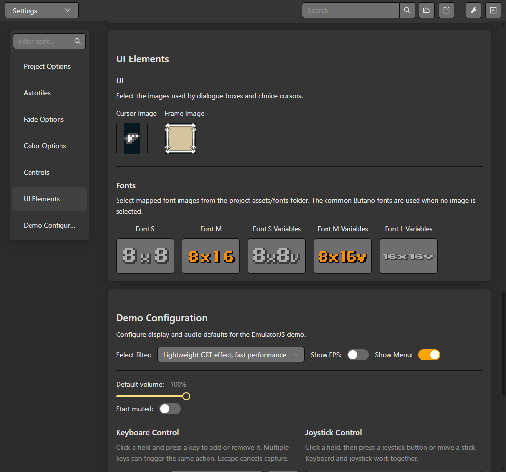

# UI and fonts

The project **Settings** editor contains the selected UI and font resources. Dialogue and UI events choose among the supported font settings; the selected font must include the glyphs used by the text.

## Configure and preview a font

1. Open **Settings** and select the font resource for the project or dialogue UI.
2. Review its glyph mapping, character widths and preview. Use a mapped font asset when the project requires a custom character set.
3. In a dialogue event, select the font and set the frame, alignment and animation options.
4. For positioned UI, use **UI Set Text**, **UI Set Value** or the corresponding UI event and set coordinates in the GBA screen space.
5. Build and preview the ROM. Check narrow glyphs, line wrapping, alignment and the last visible row on the target screen.

*UI Elements selects the dialogue images and mapped fonts used by the project.*

The editor preview helps inspect mapping and layout; it cannot prove runtime rendering for every string. Text width depends on the selected glyph map and per-character advance values. Keep text within the available screen area and verify it in the emulator. See [Dialogue and choices](./dialogue) and [Limits and compatibility](../reference/limits-and-compatibility).

## Variable text, scene display and UI lifecycle

**Set UI Text** accepts the same `$` variable selector as dialogue. `${deaths}` displays the variable value; its reference characters are not charged to the byte budget. The counter uses the initial value in the editor and the runtime uses the current value. The scene camera preview and event preview resolve the initial value instead of drawing the reference syntax.

X and Y each select pixels or 16-pixel tiles. Coordinates are in the 240 x 160 GBA screen space. Text uses the selected font's glyph widths, not a fixed width for every character. UI outside the screen is clipped; multiline text advances by the selected glyph height.

A UI element has an identity used by **Animate UI**, **Hide UI**, **Show UI**, **Destroy UI** and **Stop UI Animation**. Hiding keeps its logical state for showing it again; destroying removes the element. If a variable changes, run Set UI Text again to refresh the stored text's rendered result. Rebuild these elements in Game Data Load's On Load actions when restoring a game.
