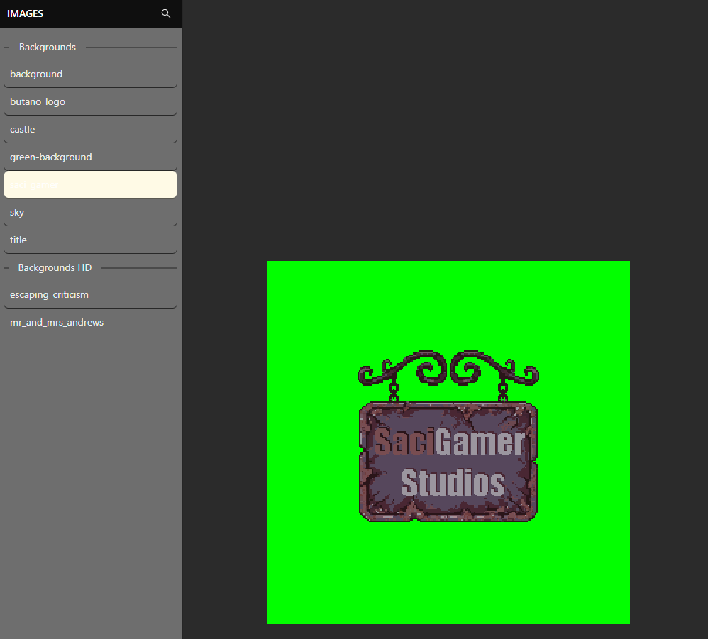

# Resource schemas

Project resources are serialized as JSON-backed `.gbasres` files and are transformed into generated C++/Butano assets during a build. Use the editor to create and update them; generated headers and build folders are derived artifacts.

Common resource records contain a stable `id`, a user-facing `name` and a resource-specific payload. Scenes refer to backgrounds, palettes, sprites, actors, triggers, variables and scripts by these identifiers. An asset path must exist and its format must be supported by the corresponding builder.

## Variable resource example

```json
{
  "_resourceType": "variables",
  "id": "8ef704a3-7ca0-4e09-af41-c49783b842b8",
  "variables": [
    {
      "id": "3e089418-5bba-4e48-b24b-3e59e313a9d4",
      "name": "Deaths",
      "symbol": "deaths",
      "type": "number",
      "initialValue": 0
    }
  ]
}
```

The exact fields vary by resource type and are defined by the editor interfaces and builders. If a build reports a missing symbol or invalid asset, inspect the resource identifier, generated name and source file before editing generated C++.

For image resources, use the Image Visualize view to inspect the imported result before assigning it to a scene or sprite.



Events can be attached to actors, triggers and tile layers from their event editing surfaces. The selected owner determines which script entry points are available. Use the event list to add and organize those blocks; see [Organize events](../guides/event-organization) for a current example of the list and its insertion controls.

## Identity and settings

New resource, scene, actor, trigger, layer, event and global-variable IDs are UUIDs. Display names and variable symbols are separate fields. Script parameter identifiers belong to their method signature; do not replace them with scene entity IDs.

Settings keep per-type bindings in `inputMapsBySceneType` and physical group membership in `inputGroups`. A scene instance links to a prefab with `prefabId`; `prefabEditable` controls shared editing from the scene, and `prefabEventsDetached` identifies local event copies. Use the editor instead of manually changing those flags.

A save/load action list is stored in the corresponding event's `children.then`. Full-save actions belong to `EVENT_SAVE_WRITE`; post-load actions belong to `EVENT_SAVE_LOAD`. Events use schema `version: 1`.
