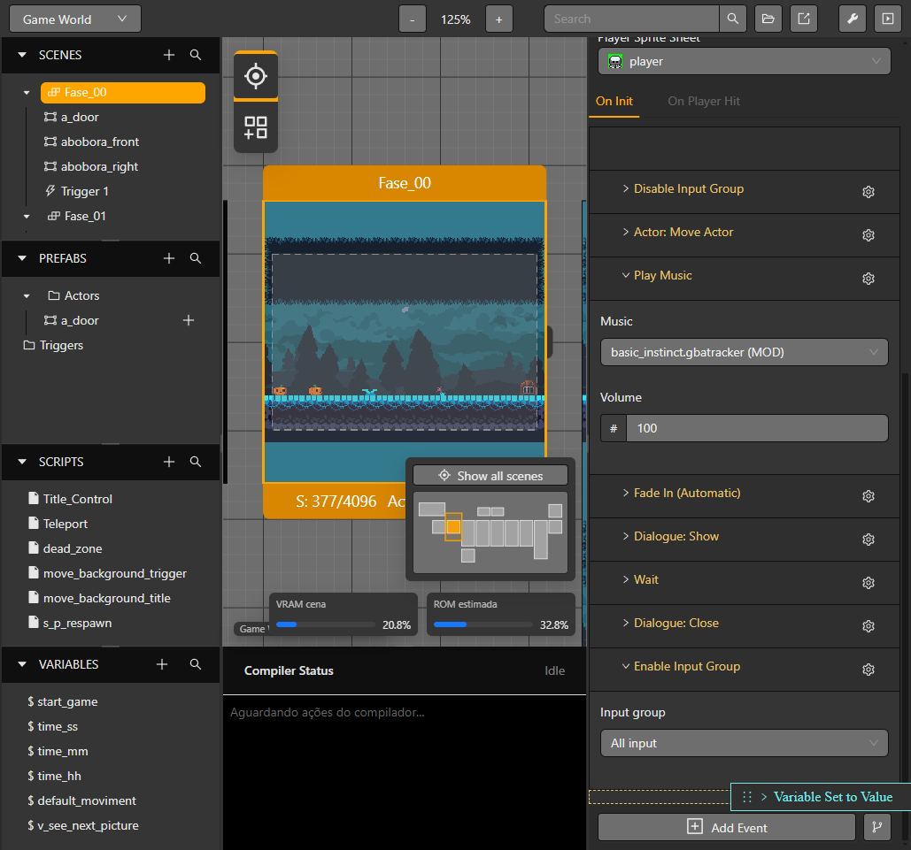
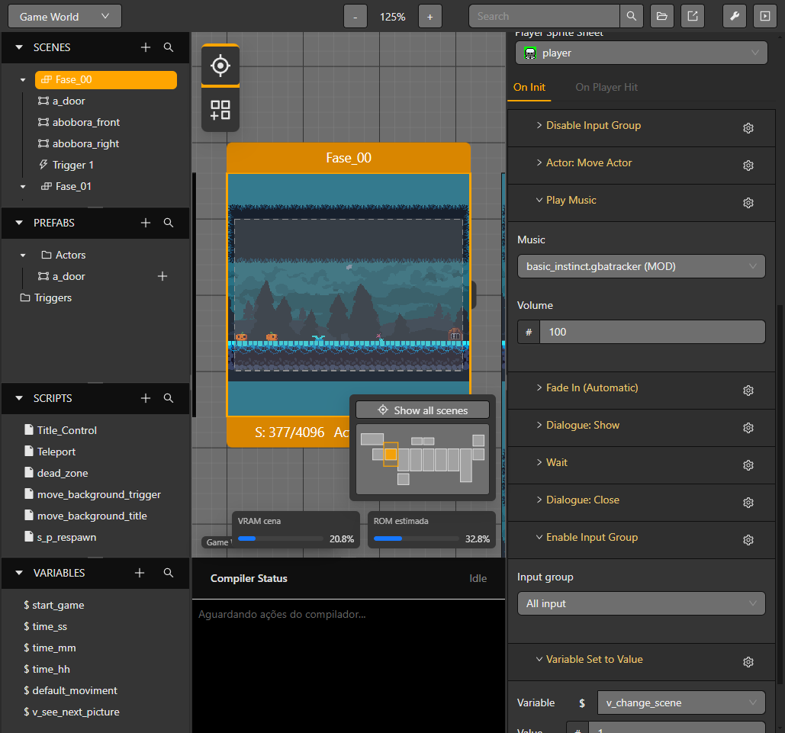
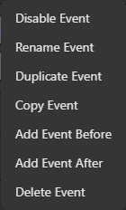
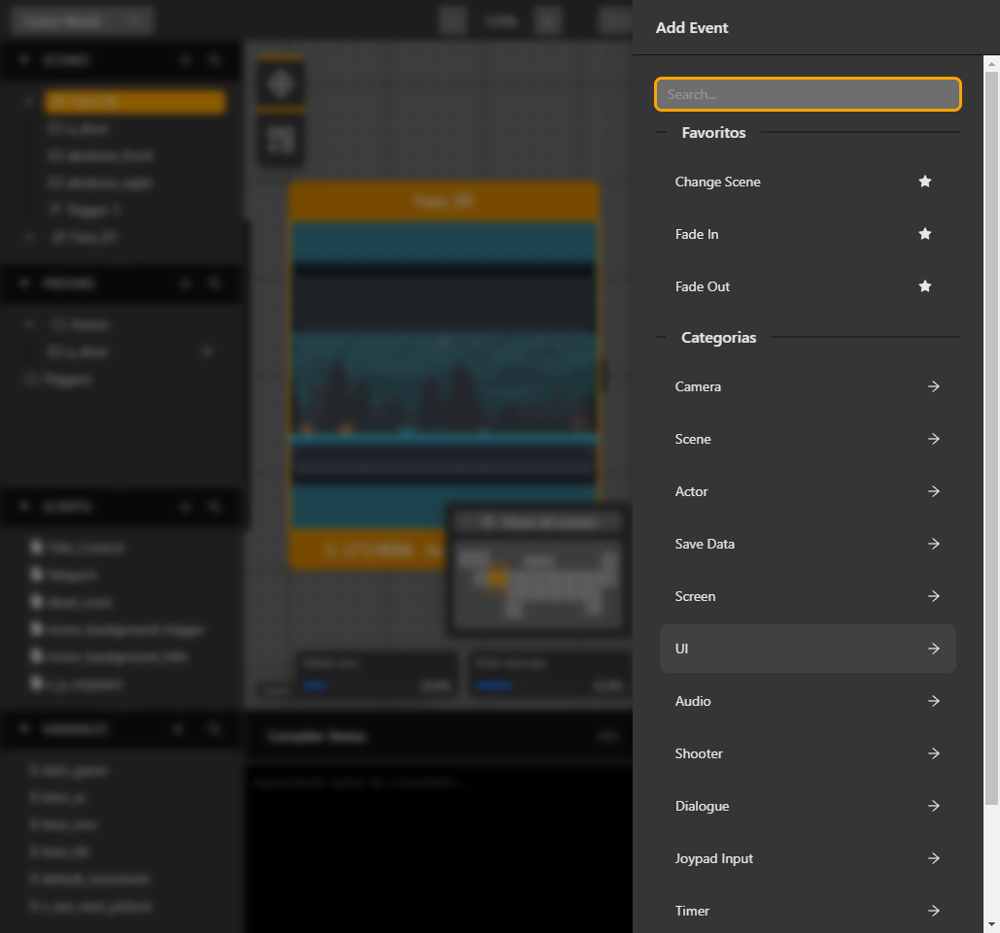
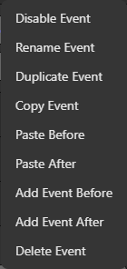

# Organizar eventos

Cada lista pertenece a la escena, actor, trigger o script reutilizable actual. Abre ese contexto y selecciona **Events** para editar la secuencia. El engranaje actúa sobre el evento junto al que aparece y muestra acciones compatibles con el contexto y el portapapeles.

## Reordenar y anidar eventos

1. Expande el evento cuyos elementos internos quieres editar.
2. Arrastra una fila hasta el marcador de inserción encima o debajo de otra. Suéltala sobre una rama para insertarla dentro de **If**, **While**, **For**, **Switch** o un callback de guardado.
3. Suelta un subevento en la lista raíz para sacarlo de su padre. El resaltado indica el destino antes de soltar el ratón.
4. Comprueba el orden final y la indentación de la rama.

Al mover, el editor conserva los identificadores. Rechaza operaciones que creen ciclos, ramas no admitidas, **Break** o **Continue** fuera de un bucle. **Switch Case** se crea desde Switch y usa el tipo de su valor.

*El marcador resaltado muestra el destino raíz antes de soltar el ratón.*

*Después de soltar, el evento que estaba al principio aparece después del último evento anterior.*

## Usar el menú del engranaje

Abre el engranaje junto a un evento. Cuando corresponda, las acciones aparecen en este orden: **Enable/Disable**, **Rename**, **Duplicate**, **Copy**, **Paste Before**, **Paste After**, **Add Before**, **Add After** y **Delete**.

- **Duplicate** crea otro evento en la lista actual.
- **Copy** guarda el evento y sus ramas anidadas. Pulsa **Esc** para limpiar el portapapeles.
- **Paste Before** y **Paste After** insertan una copia profunda respecto al evento cuyo menú está abierto. Aparecen si hay un evento compatible en el portapapeles; se generan nuevos identificadores.
- **Add Before** y **Add After** abren el selector e insertan el evento elegido en esa posición. También funcionan en filas anidadas.

El portapapeles sigue disponible al cambiar de escena o seleccionar otro actor o trigger. El destino aplica sus propias reglas y puede rechazar un evento incompatible. Revisa el bloque y sus referencias después de pegar.

Consulta [Referencia de eventos](../reference/events) para códigos y campos, y [Variables y condiciones](./variables-and-conditions) para condiciones y bucles.

## Acciones de guardar/cargar y previews

Game Data Save contiene On Save; Game Data Load contiene On Load. Las acciones se ejecutan automáticamente después de la operación correcta. Consulta [Guardar y cargar](./save-and-load).

En previews anidados, el hijo tiene prioridad mientras sus controles están bajo el cursor o enfocados, incluso tras desplazar la lista.
