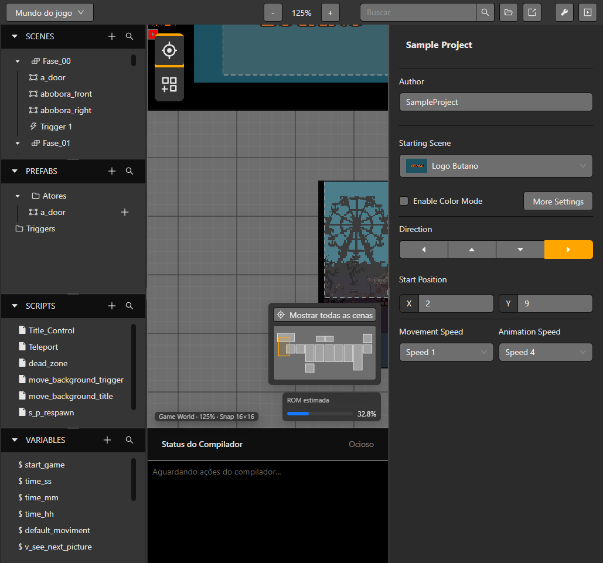

# GBA Studio

GBA Studio es un editor para Windows que permite crear juegos para Game Boy Advance con un flujo visual. Las escenas, actores, fondos, scripts, variables y audios se editan en la herramienta y después se convierten a C++ y se compilan con [Butano](https://github.com/GValiente/butano).

Estas páginas describen la aplicación de escritorio distribuida y su flujo de proyectos. Las instrucciones para mantener el monorepo están en [Contribuir](./contributing).

## Límites importantes

El objetivo es Game Boy Advance. Los formatos de assets, tiles, paletas, eventos y el runtime dependen del editor y compilador actuales. Las funciones que no aparecen en el editor o compilador no se consideran compatibles.

## Ruta recomendada

1. [Instala la herramienta](./installation).
2. Sigue el tutorial de [primer proyecto](./getting-started/first-project).
3. Lee la [visión general del motor](./concepts/engine-overview).
4. Compila y prueba la ROM con la guía de build y release.

*Game World combina la navegación del proyecto con el espacio de trabajo de la escena.*
