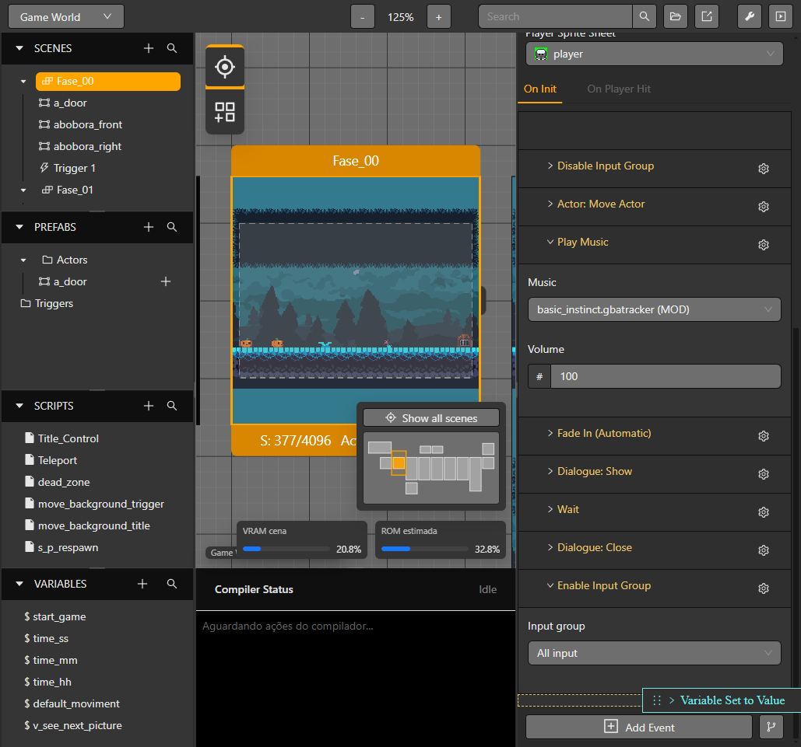
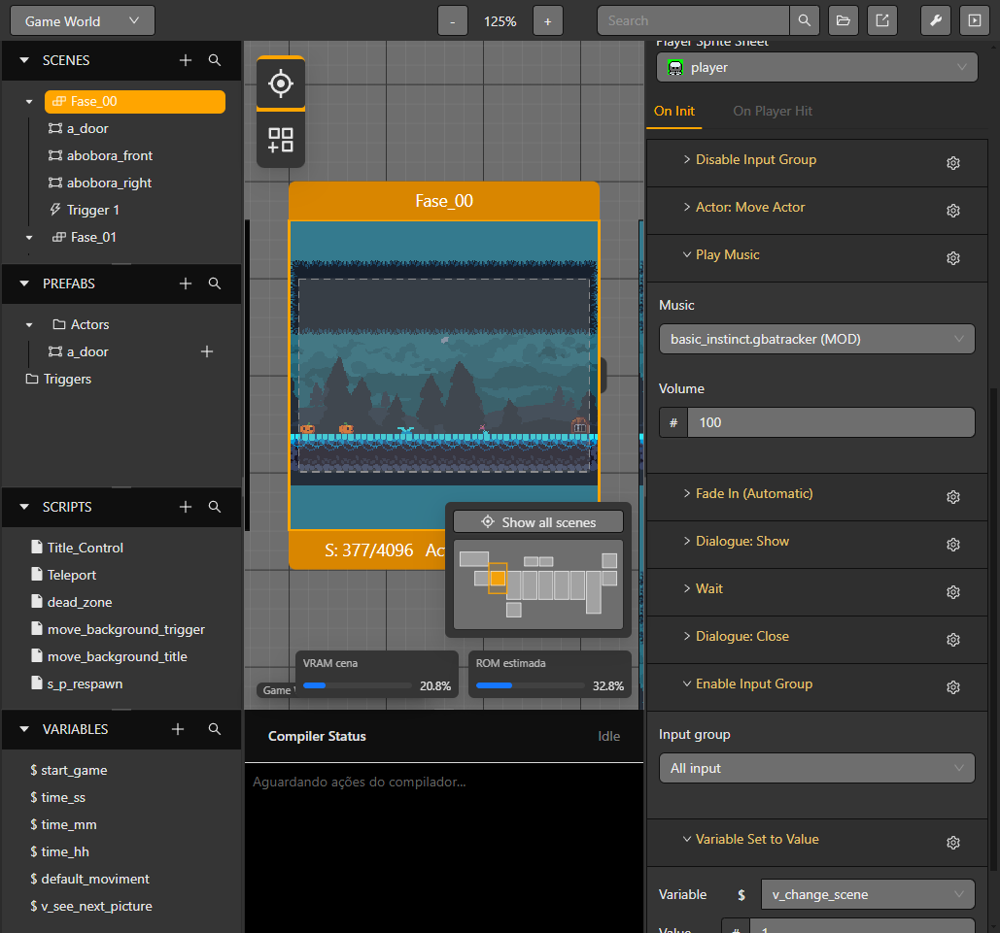
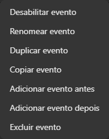
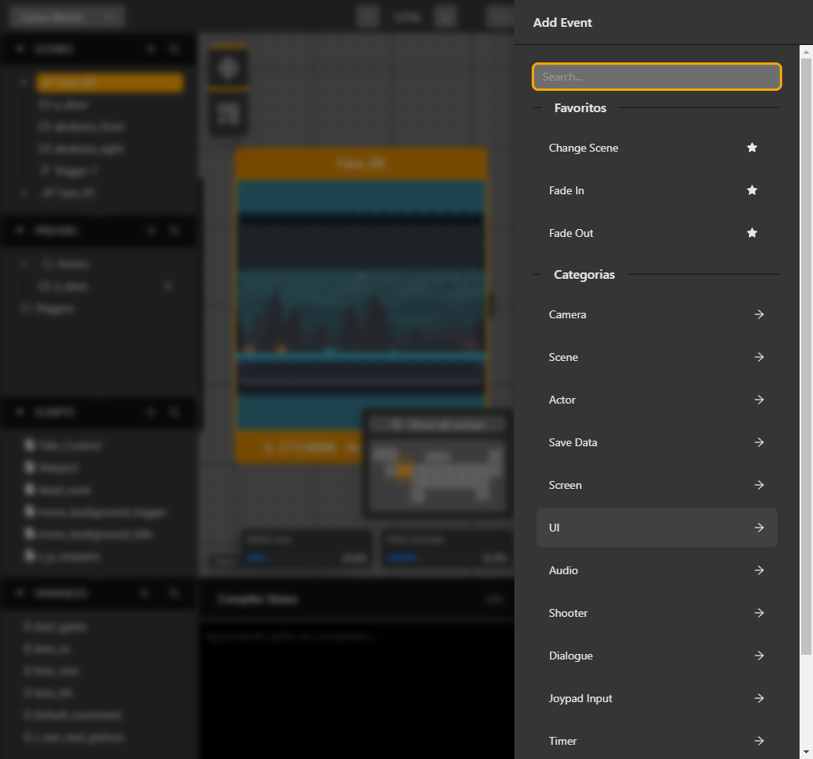
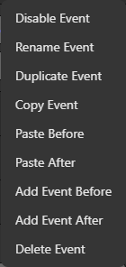

# Organizar eventos

Uma lista de eventos pertence à cena, ator, trigger ou script reutilizável atual. Abra esse contexto e escolha **Events** para editar a sequência. A engrenagem age sobre o evento ao lado dela e mostra as ações compatíveis com o contexto e a área de transferência.

## Reordenar e aninhar eventos

1. Expanda o evento que contém os filhos que deseja editar.
2. Arraste uma linha até o marcador de inserção acima ou abaixo de outra linha. Solte sobre um ramo para inserir dentro de **If**, **While**, **For**, **Switch** ou callback de salvamento.
3. Solte um subevento na lista raiz para removê-lo do pai. O destaque indica o destino antes de soltar o mouse.
4. Confira a ordem final e a indentação do ramo.

Ao mover, o editor preserva os IDs dos eventos. Ele rejeita movimentos que criem ciclos, ramos não suportados, **Break** ou **Continue** fora de um loop. **Switch Case** é criado pelo Switch e usa o tipo de seu valor.

*O marcador destacado mostra o destino raiz antes de soltar o mouse.*

*Depois de soltar, o evento que estava no início aparece após o último evento anterior.*

## Usar o menu da engrenagem

Abra a engrenagem ao lado de um evento. Quando aplicáveis, as ações aparecem nesta ordem: **Enable/Disable**, **Rename**, **Duplicate**, **Copy**, **Paste Before**, **Paste After**, **Add Before**, **Add After** e **Delete**.

*A captura usa a interface em português e mostra as ações de duplicar, copiar e inserir.*

- **Duplicate** cria outro evento na lista atual.
- **Copy** guarda o evento e seus ramos aninhados. Pressione **Esc** para limpar a área de transferência.
- **Paste Before** e **Paste After** inserem uma cópia profunda em relação ao evento cujo menu está aberto. A opção aparece quando existe um evento compatível na área de transferência; novos IDs são criados.
- **Add Before** e **Add After** abrem o seletor e inserem o evento escolhido naquela posição. Também funcionam em linhas aninhadas.

A área de transferência continua disponível ao trocar de cena ou selecionar outro ator ou trigger. O destino ainda aplica suas próprias regras e pode recusar um evento incompatível. Revise o bloco e suas referências de recursos após colar.

Consulte [Referência de eventos](../reference/events) para códigos e campos, e [Variáveis e condições](./variables-and-conditions) para condições e loops.

## Ações de salvar/carregar e previews

Game Data Save contém apenas On Save; Game Data Load contém apenas On Load. As ações executam automaticamente depois do sucesso da operação. Consulte [Salvar e carregar](./save-and-load).

Quando há previews aninhados, o filho prevalece enquanto seus controles estão sob o mouse ou com foco, inclusive depois de rolar a lista.
